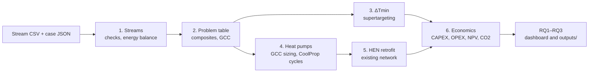

# Heatpump-Pinch: pinch analysis and heat pump integration for industrial sites

[](https://heatpump-pinch.streamlit.app)
[](https://github.com/TheJohn01/Heatpump-Pinch/actions/workflows/tests.yml)
[](LICENSE)

Electrification of process heat with high-temperature heat pumps.

**Online app:** <https://heatpump-pinch.streamlit.app> (Streamlit Community Cloud; the first
load after a period of inactivity takes up to a minute while the app wakes up).



The toolkit works for any process described by a stream table: it computes energy
targets, composite curves and the Grand Composite Curve (GCC), sizes heat pumps from
the GCC at the sink levels you choose, and flags designs outside reported heat pump
technology ranges. Site-specific data live only in a **case file** and a **stream CSV**.

## Quick start

```bash
pip install -r requirements-dev.txt               # exact tested versions (Python 3.13)
python -m pytest                                  # 147 tests (about 3 min)
python analyse.py --all                           # every case in cases/
python analyse.py cases/brewery_padulles2026.json # one case
streamlit run app.py                              # interactive front end
```

`pip install -e ".[app,dev]"` installs the package with loose version bounds instead
(`pyproject.toml`); `requirements.txt` pins the versions that produced the committed results.

## Interactive front end (`app.py`, `app_pages.py`)

Three pages in a top navigation bar (no sidebar), over the same `analyse.compute`
used by the command line and the tests (no calculation of its own):

* **Workflow**: a step-by-step wizard following the method (1 streams, 2 targets,
  3 ΔTmin, 4 heat pumps, 5 retrofit, 6 economics). Steps with many inputs use a split
  workspace: inputs on the left, results on the right. Inputs persist across steps and pages.
* **Dashboard**: RQ1–RQ3 on one screen with the consolidated sensitivities and the
  tornado chart; "Recompute table" re-runs every sensitivity for the current inputs (≈15 s).
* **Sources**: provenance of every input, the assumptions register, downloads (zip of all
  outputs, summary as Markdown/JSON).

Cases whose source publishes no annual basis, film coefficients or existing network (the milk
evaporator and four-stream cases; the spray dryer's 6000 h/year come from Liang et al., 2022): switch on **Convert to annual figures** in step 1 and enter operating hours,
and fill the `h_kW_per_m2K` column, to run ΔTmin supertargeting (step 3, cost sweep only) and the
economics (step 6, default prices and cost functions). These values are your assumptions and are
recorded as such on the Sources page. Step 5 needs the existing heat-exchanger network for an exact
retrofit; where none is published it shows a bracket (`pinch.retrofit.retrofit_bounds`): the plant with
no heat recovery (published for the spray dryer, Liang et al. 2022), a new network at the targets
(area and units targets costed with the case's cost law), heat pumps on either, and the lower bound
of a plant already at target (= step 6). `retrofit_bounds.baseline_status` in the case file says which
end is realistic (milk evaporator: the lower bound).

Charts are interactive (Altair, `pinch/charts.py`): hover for values, wheel to zoom, drag to
pan, menu to export PNG/SVG. Results are cached per set of inputs. Input errors are shown as
messages. Tests: `tests/test_app.py` (every step and case, input persistence, dashboard,
sources) and `ui_smoke.py` (browser: upload, malformed file, cell edit).

Hosting: the online app runs on Streamlit Community Cloud (servers in the United States).
Anything uploaded there passes through that provider, so use published or anonymised data only;
for confidential plant data, run the app locally (`streamlit run app.py`).

## Analysing a new site

1. Write the stream table as CSV: `stream, type, T_in_C, T_out_C, dT_shift_K` and one of
   `Q_<unit>` (e.g. `Q_kW`, `Q_kWh_per_t`) or `CP_<unit>` (e.g. `CP_kW_per_K`).
   Latent loads: use a 1 K temperature interval.
2. Copy `cases/TEMPLATE.json`, point it to the CSV, and set the heat pump sink levels,
   source temperature, Lorenz efficiency and (optionally) the annual basis.
3. Fill in `provenance`: for every value, say whether it is published or assumed, and
   where it comes from.
4. Run `python analyse.py cases/<your file>.json`.

## Status

| Workflow step | Status |
|---|---|
| 1. Stream data, checks, energy-balance closure | Done, tested |
| 2. Problem table, composite curves, GCC | Done, validated (four-stream example; Padullés et al. 2026) |
| 3. ΔTmin / cost trade-off | Done: Bath area target, units target, supertargeting; validated on the OU area example (published error found and corrected). Brewery RQ2 with the Stampfli et al. (2018) plate-HEX cost law (bare and ×3.5 installed) plus a sweep |
| 4. Heat pump placement | 4a done: Lorenz COP, placement rules, GCC sizing, screening, general design. 4b done: CoolProp cycle model (single stage, SLHX, expander, two-stage, cascade), practical limits (Annex 58), working-fluid screening, cycle-based η_L and economics; validated on Andersen et al. (2024) Appendix A |
| 5. HEN retrofit | Done: existing-network evaluation (direct and storage-based matches), pinch diagnostics (energy gap = cross-pinch + heaters below + coolers above), network-constrained heat pump sizing, retrofit options with exchanger and storage costs; brewery: paper's Pfaduko + HR tank reproduced (11.3 kWh/hl) |
| 6. Economics | Done: CAPEX (Padullés Table 3), OPEX, payback, NPV, CO2, primary energy; RQ1 electrification curve; RQ3 break-even ratio; named scenarios and Lorenz-efficiency sensitivity; paper Sec. 5.2 statements and Appendix B (Case DK1) NPV/payback reproduced |

## Layout

```
analyse.py                   General entry point: compute() in memory, write() to outputs/<case>/
app.py, app_pages.py         Streamlit front end (Workflow / Dashboard / Sources) over analyse.compute
pyproject.toml, requirements*.txt  Packaging; exact tested versions
cases/
  TEMPLATE.json              Documented template for a new site
  brewery_padulles2026.json  Main case (Padullés et al., 2026)
  fourstream_example.json    Four-stream chemical process (non-food demonstration)
  walmsley2024_milk_evaporator.json  Dairy: MVR milk evaporator, kW (Walmsley et al., 2024)
  walmsley2024_spray_dryer.json      Dairy: milk powder spray dryer, kW (Table 1 as published; see warning);
                                     6000 h/year and air-side U from Liang et al. (2022), the stream data's source
data/
  brewery_streams.csv        Padullés et al. (2026), Table 2; 'Amb.' = 15 °C (inferred)
  fourstream_example.csv     Univ. Oklahoma ChE notes, Example 1.1
  fourstream_balanced_ou.csv Same example with the utilities of the OU area-targeting notes
  northwestern_4stream.csv   Northwestern Univ. design wiki example (second algorithm check)
  walmsley2024_*.csv         Walmsley et al. (2024), Tables 1 and 2
  reference_targets.json     Published/textbook targets used by the validation tests
  brewery_configurations.json  Paper's three configurations; values tagged published/figure/assumed
  brewery_networks.json      Existing network (Pfaduko + HR tank, paper Sec. 4.2) and the condensate retrofit
pinch/
  streams.py                 Load, validate, shift, energy balance
  problem_table.py           Problem Table Algorithm (cascade, targets, pinch)
  curves.py                  Composite curves and GCC data
  heat_pump.py               Lorenz COP, heat pump units, integration, GCC sizing
  cycle.py                   Vapour-compression cycles with CoolProp (step 4b)
  cycle_analysis.py          Working-fluid screening of a design; selected fluid per unit
  network.py                 Existing heat-exchanger networks: utilities, pinch diagnostics, constrained stream set
  retrofit.py                Retrofit options (new recovery, storage, heat pumps) against the existing network
  design.py                  Automatic multi-level design and plausibility screening
  case.py                    Case files and annual (MWh/year) conversion
  plotting.py                Figures (returned, or saved to file)
  charts.py                  Interactive charts for the front end (Altair)
  results.py                 Outputs container: summary, tables, figures; write to disk
  validation.py              Reference vs computed comparison
  economics.py               Cost functions, evaluation, break-even ratio (defaults with sources)
  economic_analysis.py       Per-case economics: RQ1 electrification curve, RQ3 break-even, sensitivities
  area.py                    Area target (Bath formula), units target, ΔTmin supertargeting
  area_analysis.py           Per-case supertargeting (RQ2) from the case's area_targeting block
tests/                       147 tests (incl. app smoke tests, cycle model, network retrofit) (validation cases first, then general behaviour)

ASSUMPTIONS.md               Register of every assumption: verified / decision / conservative / limitation
ui_smoke.py                  Browser smoke test of the app (upload, bad input, cell edit)
consolidate_rq.py            RQ1-RQ3 answers with one-at-a-time and combined sensitivities
                             (outputs/<case>/rq_consolidated.csv/.md, rq_tornado.png)
screen_cycles.py             Step 4b: screen the fluids listed in a case file (minutes); analyse.py then
                             adds the cycle-based design to the summary

Paper-specific scripts (brewery):
validate_targets.py                 Steps 1-2 validation report
reproduce_padulles2026.py           Reproduces the paper's three configurations (Sec. 4.3)
reproduce_padulles2026_economics.py Reproduces the paper's economic statements (Sec. 5.2) and option maps
verify_padulles2026_assumptions.py  Checks each modelling assumption against the paper

Paper-specific script (dairy):
verify_walmsley2024.py              Targets, COP, inconsistencies and inferred variant (Walmsley et al., 2024)
```

## Conventions

* Each stream has its own temperature shift (`dT_shift_K`): T* = T − shift (hot), T* = T + shift (cold).
* Heat pump sink and source temperatures are compared directly with T* (utility shift 0),
  as in Padullés et al. (2026, Sec. 4.1). Isothermal sinks and sources are modelled over 1 K;
  results are unchanged for widths ≤ 1 K (tested).
* COP: Lorenz-efficiency model, COP = η_L · T̄_sink / (T̄_sink − T̄_source), with entropic mean
  temperatures; η_L ≤ 1 enforced (second law).
* Annual figures are reported only when the case file gives an explicit production or
  operating-hours basis.

## Plausibility screening (defaults, overridable per case)

| Check | Threshold | Source |
|---|---|---|
| Sink temperature, warning | > 160 °C | IEA HPT Annex 58 Task 1 report (Sept. 2023): commercial availability projected up to 160 °C by 2025–26 |
| Sink temperature, outside range | > 200 °C | Annex 58 scope (100–200 °C); vendor claims up to 200 °C (e.g. ENERIN, 2024; not peer-reviewed) |
| Temperature lift | > 130 K | Arpagaus et al. (2018): commercial COP data up to 130 K lift (dated; no newer verified source) |
| COP | < 1 | Direct electric heating would use less electricity |

## Validation

| Case | Quantity | Reference | Computed | Deviation |
|---|---|---|---|---|
| Four-stream example | Qh,min / Qc,min / pinch T* | 7.5 MW / 10.0 MW / 145 °C | 7.5 / 10.0 / 145 | 0 |
| Second four-stream example (Northwestern) | Qh,min / Qc,min / pinch T* | 2900 kW / 600 kW / 90 °C | 2900 / 600 / 90 | 0 |
| Milk evaporator (Walmsley 2024) | Qh,min / Qc,min | 3.54 / 0.46 MW | 3.542 / 0.456 | within rounding |
| Milk evaporator | Simple-design COP (15 → 105 °C, 50 % Carnot) | 2.1 | 2.101 | +0.05 % |
| Brewery | Qh,min | 10.0 kWh/hl | 10.04 | +0.4 % |
| Brewery | Qc,min | 3.2 kWh/hl | 3.44 | +7.6 % (known Table 2 rounding gap) |
| Brewery | Heat recovery | 11.4 kWh/hl | 11.36 | −0.4 % |
| Brewery + 2 K | Qh,min / Qc,min / recovery | 10.5 / 3.8 / 10.9 | 10.48 / 3.88 / 10.92 | ≤ 2.2 % |
| Brewery, config. 2 | Electricity | 3.6 kWh/hl | 3.55 | −1.5 % |
| Brewery, config. 3 (HTHP) | Electricity | 3.6 kWh/hl | 3.56 | −1.1 % |
| Brewery, config. 1 | Electricity vs Fig. 11 (digitised), 100–180 °C | curve | curve | −4.5 to +0.7 % |
| Cycle model vs Andersen et al. (2024) App. A | SLHX R-600 / transcritical R-744 with expander / cascade R-1234ze(Z)+R-602 | COP 4.94 / 2.69 / 2.62 | 4.99 / 2.69 / 2.79 | +1.1 / +0.1 / +6.5 % |
| Cycle model vs Andersen et al. (2024) Fig. 2 | SLHX R-602 | COP 3.02 | 3.53 | +17 % (unexplained; published η_Lor not consistent with the stated conditions) |
| Brewery existing network (Padullés Sec. 4.2) | Q̇h / recovery / Q̇c | 11.3 / 10.1 / 4.7 | 11.30 / 10.10 / 4.70 | 0 |
| Brewery, condensate into the tank | Q̇h vs indirect target (+2 K) | 10.5 (paper), 10.48 (ours) | 10.485 | 0 vs ours |
| Brewery, heat pumps on the existing network | Warm-water heat pump duty (Fig. 14) | 8.3 | 8.30 | 0 |
| Brewery, Appendix B Case DK1 | NPV10 and payback of 8 options (Table B.4) from their OPEX and CAPEX | Table B.4 | all within rounding | ≤ 0.08 M EUR |

### Known inconsistencies in the source papers (reported, not corrected)

* Brewery (Padullés et al., 2026): Q̇c,min rounding gap (Table 2); MVR COP 15 vs stated η 0.55; config. 3 EB total 4.6 vs Fig. 17 sum 4.4; Fig. 11 'EB + Ref. with HR' 11.0 < 11.3 kWh/hl; Fig. 4 GCC about 0.4 kWh/hl below Table 2 at both ends (consistent with an ambient of about 11 °C, while Sec. 4.3.1 states 15 °C). Targets change by about 0.1 kWh/hl per K of ambient.
* Spray dryer (Walmsley et al., 2024): published targets 4.98 / 3.99 MW violate the first law for Table 1 (net surplus +0.84 MW vs −0.99 MW). They are reproduced (4.978 / 3.986 MW) if Exhaust 2 ends at 23 °C and the fluidised bed starts at 25 °C, values inferred from Fig. 5, not published.
* Milk evaporator (Walmsley et al., 2024): the text's pinch range (5.5–10.5 °C) needs a 2.5 K contribution for chiller water; Table 2 gives 0.5 K. Targets are unaffected.

### Economic defaults

Every default in `pinch/economics.py` (`DEFAULTS`) carries its source:

| Parameter | Default | Source |
|---|---|---|
| Boiler efficiency (GCV) | 0.845 | DEA Technology Data, Industrial Process Heat, sheet 6.1: 93.9 % net, × 0.90 (NCV/GCV) |
| Gas emission factor | 0.182 kg/kWh (GCV) | IPCC 2006 Guidelines, Vol. 2, Table 2.2: 56,100 kg CO2/TJ NCV |
| Grid emission factor | 0.107 kg/kWh | APA (2025), Portugal 2023, production-based |
| Primary energy factor, electricity | 1.9 | Delegated Regulation (EU) 2023/807 |
| Chiller COP (refrigeration credit) | none by default; brewery 4.45 | Sinnott and Towler (2020), Sec. 6.4.4: 0.6 × Carnot (−6 °C / 30 °C); CoolProp ammonia cycle check 4.52 |
| O&M | heat pump 2,494 €/MW·y + 3.6 €/MWh; boiler 1.23 €/MWh avoided | DEA Technology Data, Industrial Process Heat, sheets 2.a and 6.1 (2025); `NO_OM` reproduces Padullés et al. (no O&M) |
| Heat-exchanger cost (brewery) | 6,841 + 912 A^0.95 EUR | Sinnott and Towler (2020), Table 6.6 plate and frame × 3.5 (Hand, Table 6.3), CEPCI 2023, ECB 2023 |

Cases without published economics (dairy, four-stream) carry their own `economics` block with
assumed, sourced inputs: Eurostat Portugal 2026-S1 prices for their consumption band at 8000 h/year
(milk evaporator: gas I5 0.0420, electricity IE 0.0897 €/kWh), and heat pump investment from the Danish Energy Agency
catalogue by sink temperature (`heat_pump_cost_classes`: sheet 1.1 ≤ 60 °C 0.95, 2.a ≤ 125 °C 1.2,
2.b ≤ 150 °C 1.55 M€/MW; above 150 °C extrapolated and flagged) with the catalogue's add-ons
(`heat_pump_cost_adders`: lift above 75 K +0.15/0.2, steam generation +0.2 M€/MW) and a scenario with
the new hot-water piping cost. Price bands are checked at site level where the site is known (dairy:
30 t/h milk-powder plant, Walmsley et al. 2016); the case notes say how the bands move with the hours. Padullés et al.'s single function
(Table 3) stays for the brewery, whose results it reproduces.

A case lists further values under `economics.scenarios` (each scenario overrides named
parameters and reports the full design, RQ1 and RQ3 again) and further Lorenz efficiencies under
`heat_pumps.eta_lorenz_sensitivity` (heat pumps re-sized and re-costed). `heat_pump_design.csv`
also gives the Lorenz efficiency predicted by the Andersen et al. (2024) correlation for each unit,
with its validity-range flags, as a check on the assumed value.

### Area-targeting validation

The University of Oklahoma "Units and Area Targeting" notes give a total area of 2716.3 m² for the
four-stream example with utilities (U = 0.001 MW/m²K). Intervals I–V are reproduced exactly. Interval
VI's printed ΔT_LM (81.9 K) uses the cold temperatures of interval V; with its own temperatures it is
56.6 K, and the corrected total (2757.3 m²) equals our composite-curve area (2757.0 m²).

## Licence, data and citation

* **Code**: MIT licence (`LICENSE`).
* **Data**: the stream tables and reference values in `data/` are transcribed from the cited
  publications (Padullés et al., 2026, *Energy Conversion and Management*, CC BY; Walmsley et al., 2024, MDPI *Energies*,
  CC BY 4.0; textbook and lecture-note examples) and remain subject to their original terms;
  cite the original sources when reusing them. `data/sources/` holds Eurostat and ECB series,
  reused with acknowledgement of the source as their reuse policies require.
  The MIT licence does not cover these data.
* **Citation**: see `CITATION.cff` (GitHub shows a "Cite this repository" button).

