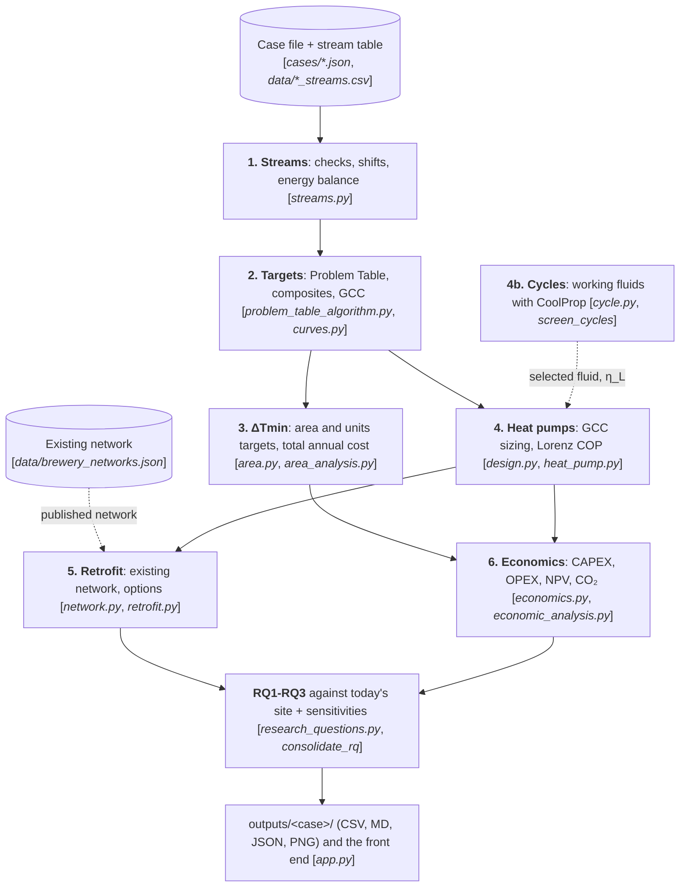
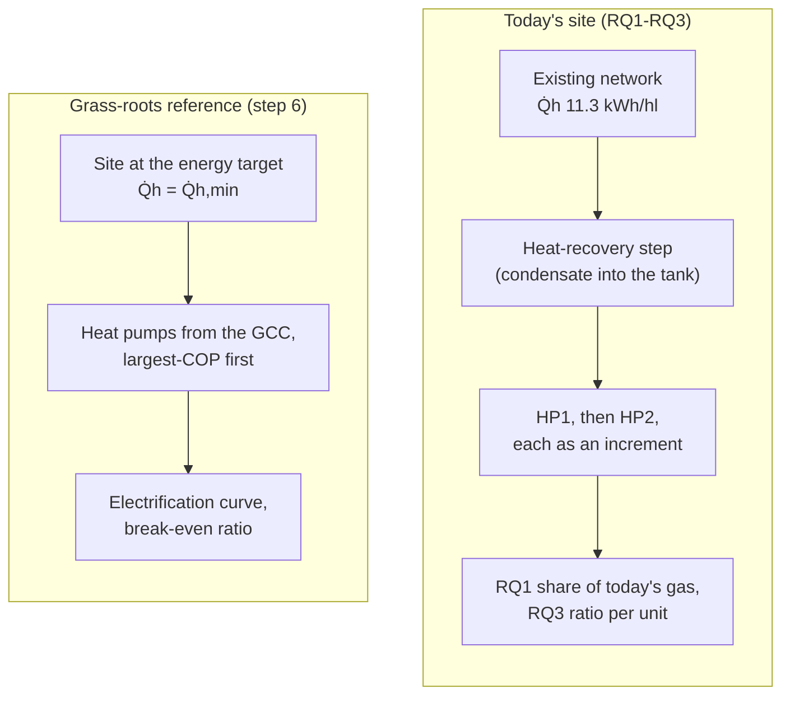
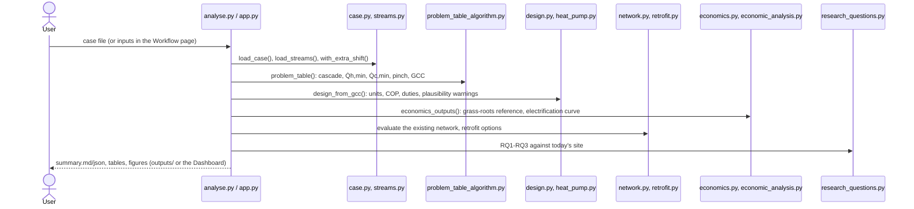
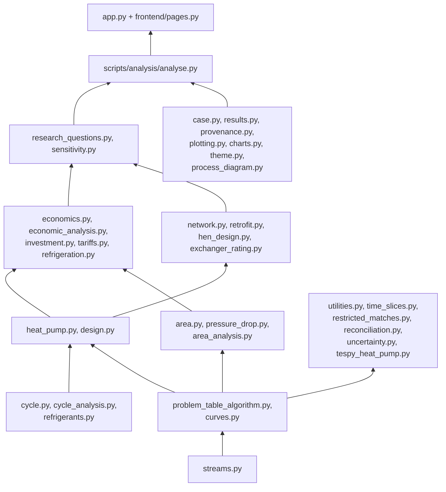
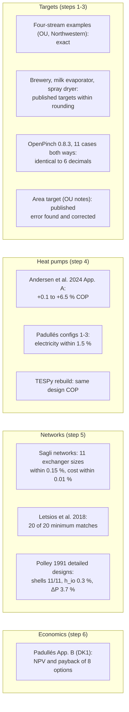

[](https://github.com/TheJohn01/Heatpump-Pinch/actions/workflows/tests.yml)    [](https://heatpump-pinch.streamlit.app)    [](LICENSE)

# Heatpump-Pinch

**Pinch analysis and high-temperature heat pump integration for the electrification of industrial process heat, with a techno-economic analysis**

A toolkit that takes the stream table of an industrial site, computes its energy targets, places and
sizes heat pumps from the Grand Composite Curve, evaluates the existing heat-exchanger network and
its retrofit, and prices the result (investment, operating cost, NPV, payback, CO₂, primary energy),
with a Streamlit front end. Main case: a generalised brewery; secondary cases: a milk evaporator, a
milk powder spray dryer and a four-stream textbook process.

---

## Abstract

Most industrial process heat below 200 °C is still raised in gas boilers. Heat pumps can supply
part of it with electricity, but only where a heat source and a heat sink exist at the right
temperatures, and only if the electricity they use costs less than the gas they save. Pinch
analysis answers the first question: the Grand Composite Curve (GCC) shows how much heat a site
needs above its pinch and how much it rejects below it, and a heat pump placed across the pinch
moves heat from the second to the first. Economics answers the second.

This work implements both, as one traceable chain. Stream data (with individual temperature
contributions ΔT_shift) feed the Problem Table Algorithm, the composite curves and the GCC; heat
pumps are sized from the GCC at chosen sink levels, with the coefficient of performance (COP) from
a Lorenz-efficiency model and, in a second step, from vapour-compression cycles of real working
fluids (CoolProp), screened against practical limits and the EU F-gas Regulation. The existing
heat-exchanger network of the site is evaluated (energy gap, cross-pinch heat), retrofit options
are built on it, and every option is priced with the cost functions of the source publication.
The research questions are answered against the site as it is today:

1. **RQ1:** what share of the gas use can heat pumps replace with an incremental payback under
   5 years?
2. **RQ2:** what ΔTmin minimises the total annual cost at current energy prices?
3. **RQ3:** up to what electricity-to-gas price ratio does electrification stay competitive?

For the brewery of Padullés et al. (2026) at 1 Mhl/year, Portuguese 2026-S1 prices (electricity
0.1135, gas 0.0512 €/kWh, ratio 2.22) and the published cost functions: the energy targets are
reproduced (Q̇h,min 10.04 vs 10.0 kWh/hl, pinch T* 17 °C); a heat-recovery step (condensate into the
hot-water tank) saves 7.2 % of today's gas with a 1.1-year payback; the warm-water heat pump then
replaces a further share, for **66.2 % of today's gas (RQ1)** at an incremental payback of 4.29 years,
NPV₁₀ +0.87 M€ and 1,441 t CO₂/year avoided. Its break-even electricity-to-gas ratio is **3.59
(RQ3)**; the high-temperature heat pump for wort boiling never pays back at today's prices
(break-even ratio 0.91). The total annual cost is flat in ΔTmin: the optimum is 0.6 K and any value
from 0.08 to 2 K is within 1 % (**RQ2**). RQ1 is fragile: it falls to 0 % with the second-half-2025
prices, a boiler efficiency of 0.929 or without the refrigeration credit, and the Monte Carlo
analysis gives a 59 % probability of a payback within 5 years.

Each step is checked against a known answer: textbook targets, the published results of the brewery,
milk evaporator and spray dryer, an independent pinch library (OpenPinch), published cycle COPs
(Andersen et al. 2024), the network designs and detailed exchanger designs of Polley and Panjeh
Shahi (1991) and 20 minimum-matches benchmark instances (Letsios et al. 2018). 333 automated tests
and a reproducibility check of every committed output run on each push.

**Keywords:** pinch analysis; Grand Composite Curve; high-temperature heat pump; process heat
electrification; brewery; heat-exchanger network retrofit; working-fluid screening; techno-economic
analysis; break-even price ratio.

---

## Table of contents

1. [Introduction](#1-introduction)
2. [Quick start](#2-quick-start)
3. [System architecture: how it works](#3-system-architecture-how-it-works)
4. [Stream data and energy targets (steps 1-2)](#4-stream-data-and-energy-targets-steps-1-2)
5. [ΔTmin and supertargeting (step 3)](#5-δtmin-and-supertargeting-step-3)
6. [Heat pump integration (step 4)](#6-heat-pump-integration-step-4)
7. [Heat-exchanger network retrofit (step 5)](#7-heat-exchanger-network-retrofit-step-5)
8. [Techno-economic analysis (step 6)](#8-techno-economic-analysis-step-6)
9. [Results for the brewery](#9-results-for-the-brewery)
10. [Validation and known limitations](#10-validation-and-known-limitations)
11. [Software implementation, testing and reproducibility](#11-software-implementation-testing-and-reproducibility)
12. [Conclusions and future work](#12-conclusions-and-future-work)
13. [Development](#13-development)
14. [Licences, data sources and credits](#14-licences-data-sources-and-credits)
15. [References](#15-references)
- [Appendix A: Nomenclature](#appendix-a-nomenclature)

---

## 1. Introduction

### 1.1 Motivation

Process heat is the largest energy use of most industries, and in the food and beverage sector it
is mostly needed below 150 °C: pasteurisation, cleaning, evaporation, drying, mashing and wort
boiling. That range is within reach of industrial heat pumps, which deliver several units of heat
per unit of electricity. Whether a heat pump is worth installing depends on three things the site
data decide:

- **Temperatures:** a heat pump is efficient only when the lift between its source and its sink
  is small, so it must take heat where the process rejects it and deliver it where the process
  needs it.
- **Heat recovery first:** heat the process can exchange with itself needs neither gas nor a heat
  pump. A heat pump sized before heat recovery is oversized.
- **Prices:** the heat pump saves gas and buys electricity; its value scales with the gas price
  and falls with the electricity-to-gas price ratio.

Pinch analysis handles the first two systematically; a techno-economic analysis handles the third.

### 1.2 Problem statement

| Approach | Strength | Weakness for an electrification study |
|---|---|---|
| Pinch analysis alone | Energy targets, heat recovery and correct heat pump placement from the stream data | Says nothing about cost, the real COP of a working fluid, or the existing network |
| Heat pump simulation alone | COP, pressures and fluid choice for given temperatures | Needs the source and sink temperatures and duties as input; cannot tell which ones the site offers |
| Published case studies | Real data and results | Each publishes one configuration at one set of prices, often with inconsistencies (Section 10.2) |

### 1.3 Research questions and objectives

The three research questions are listed in the Abstract. Their supporting objectives:

1. Reproduce the published targets of the case studies from their stream tables, with individual
   ΔT_shift per stream, and report every deviation.
2. Size heat pumps from the GCC (sink above the pinch, source below it), with COPs from a stated
   model whose validity range is checked, and select a working fluid that respects practical and
   regulatory limits.
3. Start from the site as it is today (its existing heat-exchanger network), not from an ideal
   grass-roots design, so that savings and paybacks are increments a plant owner would see.
4. Price every option with the publication's cost functions and sourced energy prices, and test
   the answers against one consolidated list of sensitivities.
5. Distinguish three kinds of numbers throughout: published, reproduced by us, and assumed.
6. Make every committed result reproducible from the inputs with one command.

### 1.4 Scope

- **Level:** site-level targeting and conceptual design. Detailed equipment design, controls and
  layout are outside the scope; exchanger rating stops at shells and tube side (Section 7.4).
- **Time:** continuous steady state for the main case. Non-continuous processes are handled by time
  slices and storage (Section 4.5) where a schedule is published; the brewery's is not.
- **Data:** published, peer-reviewed case studies only (no company contact, by design of the
  project). No measured plant data.
- **Heat pumps:** electrically driven vapour compression and mechanical vapour recompression (MVR);
  electric boilers as the reference for direct electrification.
- **Economics:** Portugal (Eurostat prices, Portuguese grants and CO₂ addition); costs from the
  source publications and the Danish Energy Agency catalogue.

### 1.5 Contributions

- One chain from stream table to RQ1-RQ3, run identically by the command line, the tests and the
  front end (`scripts.analysis.analyse.compute`).
- RQ1-RQ3 answered against the site's **existing network** (heat-recovery step first, then each heat
  pump as an increment), alongside the usual grass-roots reference.
- A CoolProp cycle model (single stage, suction-line heat exchanger, expander, two-stage, cascade)
  validated on published cycle COPs, with working-fluid screening against the IEA HPT Annex 58
  limits and Regulation (EU) 2024/573.
- Network synthesis (minimum units), series placement and shell-and-tube rating, validated on
  published network and exchanger designs.
- Investment-grade economics: IRR, AACE estimate classes, Portuguese grant scenarios and Monte Carlo
  on price and investment uncertainty.
- Source findings reported, not corrected: inconsistencies in the published case data (Section
  10.2) and errors in teaching material (Section 10.1).

### 1.6 Structure of this document

Section 3 describes the architecture. Sections 4-8 follow the six workflow steps: theory, equations,
parameters and data. Section 9 gives the brewery results, Section 10 the validation and limitations,
Section 11 the software and tests, and Section 12 the conclusions.

---

## 2. Quick start

```bash
git clone https://github.com/TheJohn01/Heatpump-Pinch
cd Heatpump-Pinch
python -m venv .venv
source .venv/bin/activate                 # Windows: .venv\Scripts\activate
pip install -r requirements-dev.txt       # exact tested versions (Python 3.13)
python -m pytest -q                       # full suite (about 2 min)
python regenerate_outputs.py              # rebuild every output (about 4 min; --check compares with Git)
python -m scripts.analysis.analyse --all  # every case in cases/
python -m scripts.analysis.analyse cases/brewery.json   # one case
streamlit run app.py                      # interactive front end
```

Scripts run from the repository root as modules (`python -m scripts.<folder>.<script>`).
`pip install -e ".[app,cycle,excel,rating,tespy,prices,dev]"` installs the package with loose version
bounds instead (`pyproject.toml`); `requirements.txt` pins the versions that produced the committed
results. The online app (badge above) runs on Streamlit Community Cloud; the first load after a
period of inactivity takes up to a minute.

**Analysing a new site:**

1. Write the stream table as CSV: `stream, type, T_in_C, T_out_C, dT_shift_K` and one of `Q_<unit>`
   (e.g. `Q_kW`, `Q_kWh_per_t`) or `CP_<unit>` (e.g. `CP_kW_per_K`); `.xlsx` workbooks are read too.
   Latent loads: use a 1 K temperature interval.
2. Copy `cases/TEMPLATE.json`, point it to the CSV, and set the heat pump sink levels, source
   temperature, Lorenz efficiency and (optionally) the annual basis.
3. Fill in `provenance`: for every value, whether it is published or assumed, and where it comes from.
4. Run `python -m scripts.analysis.analyse cases/<your file>.json`.

---

## 3. System architecture: how it works

### 3.1 Overview

Follow the arrows from top to bottom. Each box is one step, with the file that does it in italics.
Dashed arrows are inputs prepared once (cycle screening, published networks).



### 3.2 Two references: grass-roots and today's site

The economics are computed twice, on purpose. The **grass-roots reference** assumes a site that
already recovers heat at the energy target and asks what share of Q̇h,min heat pumps can supply
(the electrification curve, Section 8.4). The **RQ answers** start from the site as it is: its
existing network, its gas use and its coolers. A plant owner sees the second.



### 3.3 Sequence of one analysis run



### 3.4 Module dependencies



### 3.5 Front end

Three pages in a top navigation bar, over the same `compute` function as the command line (the
app does no calculation of its own):

| Page | Content |
|---|---|
| Workflow | A step-by-step wizard following the method (1 streams, 2 targets, 3 ΔTmin, 4 heat pumps, 5 retrofit, 6 economics), inputs next to the results they drive; inputs persist across steps and pages. Step 1 opens with a simplified flowsheet of the case |
| Dashboard | RQ1-RQ3 on one screen with the consolidated sensitivities and the tornado chart; "Recompute table" re-runs every sensitivity for the current inputs (about 15 s); the streams, energy targets and heat pumps on the T* axis |
| Sources | Provenance of every input, the assumptions register, downloads (all outputs as a zip, summary as Markdown/JSON) |

**Process diagrams** (`pinch/process_diagram.py`) draw the case in four views: *Process*, *Energy
balance*, *With heat pumps* and *All at once* (every layer overlaid). The flowsheet in step 1 has one
box per process step, with each step's heat demand (+, blue) or release (−, red) taken from the current
stream table, and the step 4 heat pumps with their sink and source connections. Its layout comes from
`data/<case>_flowsheet.json` (steps on a four-column grid, material flows, which steps each heat pump
serves), because a stream table has no material connections; the heat pump connections are
indicative until the network design (step 5) fixes the matches. Every published case has a layout
file; uploaded tables get a generic layout (one box per stream, no material connections). The
Dashboard shows the T* stream diagram: streams as arrows on the shifted-temperature axis with the
pinch, Q̇h,min, Q̇c,min, recovery and the heat pumps. Stream identifiers (H1, C1, ...) follow
the stream table and are the same in both diagrams.

Charts are interactive (Altair, `pinch/charts.py`). The theme is a plain technical-document style
(IBM Plex Sans and Mono, served by the app) with light and dark modes; colours carry meaning: **red
is hot** (hot streams, Q̇h, heat pump sinks) and **blue is cold** (cold streams, Q̇c, sources), and
economic charts use teal and amber instead. Text meets WCAG 2.2 AA contrast in both modes
(`tests/test_theme.py`). Cases without a published annual basis, film coefficients or network can be
completed in the app (operating hours, `h_kW_per_m2K`); those values are recorded as assumptions.
Hosting: Streamlit Community Cloud (servers in the United States); use published or anonymised data
there and run the app locally for confidential plant data.

---

## 4. Stream data and energy targets (steps 1-2)

### 4.1 Stream data and checks

Each stream has a supply and a target temperature and either a heat load or a heat capacity flow
rate CP. Latent loads (boiling, condensation) are modelled over a 1 K interval. Streams with a
variable CP are entered as segments of one parent stream. `streams.py` rejects non-physical data
(zero or negative loads, a hot stream that is heated) and reports the energy balance
(Σ Q_hot − Σ Q_cold = Q̇h,min − Q̇c,min, checked after the cascade).

**Individual temperature contributions.** Each stream carries its own ΔT_shift instead of one global
ΔTmin/2, so a film-limited gas stream can take a larger contribution than a liquid. The shifted
temperatures are

```math
T^*_{\text{hot}} = T - \Delta T_{\text{shift}},
\qquad
T^*_{\text{cold}} = T + \Delta T_{\text{shift}}
```

and two streams can exchange heat when their shifted temperatures allow it, which gives each pair
the approach ΔT_shift,hot + ΔT_shift,cold.

### 4.2 Problem Table Algorithm

The shifted supply and target temperatures, sorted, define intervals k = 1 … K. In each interval
the heat surplus is

```math
\Delta H_k = \left(\sum_{\text{hot in } k} CP_i - \sum_{\text{cold in } k} CP_j\right)\left(T^*_{k-1} - T^*_k\right)
```

and the heat cascaded out of interval k, with the hot utility Q̇h added at the top, is
R_k = Q̇h + Σ_{i ≤ k} ΔH_i. The smallest Q̇h that keeps every R_k ≥ 0 is the minimum hot utility:

```math
\dot Q_{h,\min} = \max\!\left(0,\ -\min_k \sum_{i \le k} \Delta H_i\right),
\qquad
\dot Q_{c,\min} = R_K = \dot Q_{h,\min} + \sum_{k} \Delta H_k
```

The pinch is where the feasible cascade is zero. The **Grand Composite Curve** is the feasible
cascade plotted against T*; the shifted **composite curves** are the cumulative hot and cold loads
against T* (`curves.py`, one piecewise composite sum also used by the area target and the network
evaluation).

### 4.3 Several utility levels

`utilities.py` places several utility levels against the GCC (Klemeš et al. 1997): each level, from
the coldest hot utility up, takes the heat the GCC needs below its temperature. It reproduces the
Problem Table and the brewery's GCC sizing exactly (7.2824 / 2.76 kWh/hl); a level at 80 °C is capped
at 7.28 kWh/hl by the GCC pocket at 98-102 °C T*.

### 4.4 Plant data: reconciliation, uncertainty and restricted matches

- **Reconciliation** (`reconciliation.py`, Yong et al. 2016): measured CP and temperatures adjusted by
  weighted least squares so that every exchanger closes its energy balance. The simultaneous solve
  is the default; the iterative variant of the paper puts the whole correction on the CP block.
- **Uncertainty** (`uncertainty.py`, Bergamini et al. 2019, 2021): Latin hypercube sampling of loads
  (σ 10 %) and temperatures (σ 3 K) and standardised regression coefficients, which rank the streams
  whose data matter most for the targets.
- **Restricted matches** (`restricted_matches.py`, Wang et al. 2021; Becker and Maréchal 2012): a
  transshipment LP with forbidden or limited matches (food-hygiene rules, distance); without
  restrictions it reproduces the Problem Table on all six data sets to 10⁻⁹.

### 4.5 Non-continuous processes

`time_slices.py` follows Stampfli et al. (2018, 2019): Time Average and Time Slice targets, storage
sizing, and a heat pump that works between storage loops. It reproduces the graphical-method results
of Stampfli et al. (2018, *CET* 70, 1789-1794), Table 2 (condensing 46.26 °C, evaporating −4.56 °C,
COP 2.2), and uses the 22-stream dairy of Stampfli et al. (2019), Table 1, as its validation case. The brewery stays on time-average targets because its schedule is not
published (`scripts/checks/batch_check.py` brackets the boil window instead).

---

## 5. ΔTmin and supertargeting (step 3)

### 5.1 Area and units targets

The area target follows the Bath formula (Linnhoff and Ahmad 1990): vertical heat transfer between
the composite curves, interval by interval (enthalpy intervals k), with stream film coefficients
h_j and fouling resistances R_f,j:

```math
A_{\min} = \sum_k \frac{1}{\Delta T_{LM,k}} \sum_{j \in k} q_{j,k}\left(\frac{1}{h_j} + R_{f,j}\right)
```

The units target is N_min = (S − 1) above the pinch + (S − 1) below it, with S the number of streams
and utilities present on that side.

### 5.2 Total annual cost

For each ΔTmin (all ΔT_shift scaled together), `area.py` computes the targets, the area and the
units, and the total annual cost

```math
\text{TAC}(\Delta T_{\min}) = \text{CRF}\cdot N_{\min}\left[a + b\left(\frac{A_{\min}}{N_{\min}}\right)^{c}\right] + \dot Q_{h,\min}\, c_h + \dot Q_{c,\min}\, c_c
```

with the per-unit cost law a + b A^c, the capital recovery factor CRF and the utility costs c_h, c_c. Because the optimum is often flat, the result is reported as
the ΔTmin of minimum TAC and the range within 1 % of it (`area_analysis.py`).

### 5.3 Film coefficients from pressure drop

Area targets need film coefficients; assumed values can be far from what a detailed design achieves.
`pressure_drop.py` follows Polley, Panjeh Shahi and Jegede (1990) and Polley and Panjeh Shahi (1991):
each stream's allowable pressure drop sets its coefficient through

```math
\Delta P_j = K_j\, A_{c,j}\, h_j^{\,n_j},
\qquad n = 3.5 \ (\text{tube side}),\quad n = 2.81/0.55 = 5.11 \ (\text{shell side, Kern})
```

where A_c,j is the stream's contact area (its own area contribution plus a CP-weighted share of the
opposing streams'), solved together with the Bath area by fixed-point iteration, with 90 % of the
allowable drop usable (the rest for nozzles and headers).

---

## 6. Heat pump integration (step 4)

### 6.1 Placement and sizing from the GCC

A heat pump saves energy only across the pinch (Townsend and Linnhoff 1983): its sink above the
pinch, its source below it. `design.py` sizes the units from the GCC at the sink levels of the case:
each level takes the duty the GCC needs at or below its temperature, the source is the heat the GCC
rejects below the pinch (or an external source, e.g. ambient air, when that is not enough), and the
duties are checked against the energy balance of each unit (Q̇_sink = Q̇_source + W).

### 6.2 Lorenz-efficiency COP

The first-pass COP is a fraction η_L of the Lorenz COP, the reversible COP between gliding source and
sink temperatures (`heat_pump.py`):

```math
\text{COP} = \eta_L\, \frac{\bar T_{\text{sink}}}{\bar T_{\text{sink}} - \bar T_{\text{source}}},
\qquad
\bar T = \frac{T_{\text{in}} - T_{\text{out}}}{\ln\left(T_{\text{in}}/T_{\text{out}}\right)} \ [\text{K}]
```

T̄ is the thermodynamic (entropic) mean temperature. η_L = 1 is the second-law bound, so every COP is
checked against it. The case default is η_L = 0.5; the Andersen et al. (2024) correlation is reported
for each unit, with its validity flags, as a check. An explicit approach for intermediate loops,
`dT_cont_K` (Stampfli et al. 2019, Eq. 1), lowers the sink and raises the source temperatures the
heat pump sees.

### 6.3 Cycle model and working-fluid screening

`cycle.py` replaces η_L by vapour-compression cycles of real fluids (CoolProp), with the assumptions
of Andersen et al. (2024), Table 3: pinch 3 K in the evaporator and condenser, superheat 3 K,
isentropic efficiency 70 %, compressor heat loss 5 %, motor 95 %; pressures optimised for the
highest COP subject to the pinch constraints. Layouts: single stage, with suction-line heat exchanger
(SLHX), with expander, two-stage, and cascades. `cycle_analysis.py` screens the fluids of the case
against practical limits (IEA HPT Annex 58: pressure ratio ≤ 10 per stage; ammonia ≤ 76 bar and
110 °C discharge) and `refrigerants.py` adds GWP, safety group and the prohibitions of Regulation
(EU) 2024/573. For the brewery the selected cycles are propane with SLHX (warm-water heat pump, COP
3.11) and a propane/n-butane cascade (wort boiling, COP 1.96); both fluids are A3, so EN 378 charge
and machinery-room rules apply.

### 6.4 Design check and part load with TESPy

`tespy_heat_pump.py` rebuilds the plain single-stage cycle in TESPy (Witte and Tuschy 2020), an
independent equation-oriented simulator, at the unit's capacity. With the same pressures, superheat,
subcooling and isentropic efficiency it gives the same COP (3.3546 for the warm-water unit; both
programmes use CoolProp, so this checks the cycle bookkeeping). TESPy's off-design method then
estimates the COP at part load (3.355 at 100 % to 3.090 at 60 % of the design heat), with TESPy's
generic characteristic lines, not manufacturer data: a trend, not a guarantee.

### 6.5 Mechanical vapour recompression

`scripts/checks/mvr_check.py` evaluates the paper's configuration 3 (MVR of the wort vapour plus a
booster heat pump) with a CoolProp MVR COP for 5-15 K of lift. The MVR COP is high (17-50), but the
booster is still needed and the investment is larger, so NPV₁₀ is −1.06 to −1.14 M€ against −0.86 M€
for the high-temperature heat pump: configuration 3 is not preferred.

---

## 7. Heat-exchanger network retrofit (step 5)

### 7.1 Existing network and pinch diagnostics

`network.py` evaluates a published network (direct and storage-based matches, heaters, coolers) and
splits its energy gap to the target into its causes (Tjoe and Linnhoff 1986):

```math
\dot Q_h - \dot Q_{h,\min} = Q_{\text{cross-pinch, matches}} + Q_{\text{heaters below the pinch}} + Q_{\text{coolers above the pinch}}
```

For the brewery's existing network (Padullés et al. 2026, Sec. 4.2: Pfaduko vapour condenser and the
wort-cooling hot-water tank) the gap is 1.2577 kWh/hl, all of it coolers above the pinch.

### 7.2 Retrofit options

`retrofit.py` builds options on the existing network: new recovery matches and storage, heat pumps
sized on the network-constrained stream set (what the network leaves to utilities), each with its
exchanger and storage cost. For sites without a published network, `retrofit_bounds` gives a bracket:
no heat recovery, a new network at the targets, and heat pumps on either.

### 7.3 Network synthesis

`hen_design.py` designs new networks in the sequential way:

1. **Minimum matches:** a mixed-integer linear programme on the transshipment model of the heat
   cascade with match binaries (Papoulias and Grossmann 1983, as cited): the fewest hot-cold pairs that
   achieve a given hot utility, utilities as streams of unknown load.
2. **Series placement:** the matches on each stream in temperature order, iterated until stable,
   giving every exchanger's end temperatures and any approach below the minimum.
3. **Sizing and cost:** counter-current area from 1/U = 1/h_h + 1/h_c + R_f,h + R_f,c, cost per unit
   a + b A^c.

### 7.4 Shell-and-tube rating

`exchanger_rating.py` (with ht and fluids) adds what counter-current sizing leaves out. A unit with
one shell pass and an even number of tube passes needs the LMTD correction factor F (Fakheri 2003),
and several shells in series when F is too low:

```math
A = \frac{\dot Q}{U\,F\,\Delta T_{LM}},
\qquad
N_{\text{shells}} = \min\{N : F(N) \ge F_{\min}\},\quad F_{\min} = 0.8
```

with cost N × cost(A/N). The tube side is rated from the bundle (tubes, passes, bore, length): h_i from
the Colburn relation 0.023 Re^0.8 Pr^1/3 (the relation behind ΔP = K A h^3.5), h_io with fouling and
the tube wall in series, and the straight-tube pressure drop from the Darcy friction factor.

---

## 8. Techno-economic analysis (step 6)

### 8.1 Annual energy, cost and emissions

An option is described by the gas heat it still needs Q_gas, its electricity W and its equipment.
With boiler efficiency η_b (gross calorific value), per year:

```math
F_{\text{gas}} = \frac{Q_{\text{gas}}}{\eta_b},
\qquad
\text{OPEX} = F_{\text{gas}}\,p_{\text{gas}} + W\,p_{\text{el}} + F_{\text{gas}}\,e_{\text{gas}}\,p_{\text{CO}_2} + \text{O\&M}
```

```math
\text{CO}_2 = F_{\text{gas}}\,e_{\text{gas}} + W\,e_{\text{grid}},
\qquad
\text{PE} = F_{\text{gas}}\,\frac{\text{NCV}}{\text{GCV}}\,f_{\text{PE,gas}} + W\,f_{\text{PE,el}}
```

O&M is the fixed (per unit of capacity) and variable (per MWh) cost of each item plus the boiler's
variable O&M on the gas heat. Where the heat pump sources take over refrigeration duty, the chiller
electricity they avoid is credited (chiller COP and credit fraction are case inputs).

### 8.2 Investment, NPV, payback and break-even ratio

CAPEX is the sum of the cost functions C = α + β X^γ of the equipment (Padullés et al. 2026, Table 3,
for the brewery). Against a baseline:

```math
\text{savings} = \text{OPEX}_{\text{base}} - \text{OPEX},
\qquad
\text{payback} = \frac{\Delta\text{CAPEX}}{\text{savings}},
\qquad
\text{NPV} = -\Delta\text{CAPEX} + \text{savings}\cdot\frac{1 - (1+r)^{-n}}{r}
```

Savings are linear in the electricity price, so the electricity-to-gas ratio at which an option just
pays off has a closed form. Writing savings(ρ) = A − ρ B, with B the extra electricity bought at the
gas price:

```math
\rho^{*} = \frac{A - \Delta\text{CAPEX}/\text{annuity}}{B}
\quad \text{(NPV = 0)},
\qquad
\rho^{*}_{\text{payback}} = \frac{A - \Delta\text{CAPEX}/t_{\text{threshold}}}{B}
```

### 8.3 Research questions against today's site

`research_questions.py` builds the answer as increments: today's site (existing network), then the
heat-recovery step, then each heat pump in order of decreasing COP (HP1, HP2, …), each evaluated over
the previous step. **RQ1** is the share of today's gas the heat pumps replace while every included
increment has a payback within the threshold (5 years; Cooremans 2012). **RQ3** is the break-even
ratio of each increment. **RQ2** comes from step 3. `scripts/analysis/consolidate_rq.py` evaluates
every row of the case's single sensitivity list (prices, boiler efficiency, refrigeration credit,
chiller COP, CO₂ price, emission factors, horizon, Lorenz efficiency, cycle-based COP, batch duty).

### 8.4 Grass-roots reference and the electrification curve

`economic_analysis.py` evaluates the GCC design on a site already at the energy target: the
electrification curve (share of Q̇h,min supplied by heat pumps against payback and NPV), the share
with payback within the threshold and with maximum NPV, and the break-even ratio of the full design.
This is a reference, not the RQ1 answer.

### 8.5 Investment uncertainty, grants and tariffs

- **Investment-grade indicators** (`investment.py`): IRR, discounted payback, tax and depreciation
  (Towler and Sinnott 2013, Ch. 9), AACE 18R-97 accuracy ranges (Class 5: −20 to −50 % / +30 to
  +100 %), Portuguese aid intensities (Portaria n.º 325-A/2021; Aviso MPR-2026-01) and Monte Carlo on
  investment and prices (5,000 samples, seed 0; `scripts/checks/investment_check.py`).
- **Hourly electricity prices** (`tariffs.py`): the effective price a heat pump pays over its
  operating hours (a fixed daily window, or the cheapest hours of each day with storage), plus
  per-hour network adders and a demand charge. Prices come from the ENTSO-E Transparency Platform
  through entsoe-py (`scripts/data/fetch_entsoe_prices.py`, needs an API key); no price data or ERSE
  network tariffs are committed. `scripts/checks/tariff_check.py` compares the effective ratio with
  each unit's RQ3 ratio.
- **Component cost cross-check** (`tespy_heat_pump.py`): the cost method of Kosmadakis et al. (2020),
  as implemented in heatpumps (compressor by suction volume flow, exchangers by area UA/k), gives
  0.98 M€ for the brewery's warm-water heat pump against 1.07 M€ from the Padullés cost function.

### 8.6 Economic defaults

The defaults and their sources are written once, in `pinch/economics.py` (`DEFAULTS`,
`DEFAULT_COST_FUNCTIONS`); the table below is generated from them by `regenerate_outputs.py`, whose
`--check` (CI) fails if it is stale. Each case file overrides values in its `economics` block and
gives their sources in `economics.sources` (e.g. the brewery's chiller COP 4.45 and its
heat-exchanger cost law); the reasoning behind each choice is in `docs/ASSUMPTIONS.md`.

<!-- BEGIN generated: pinch.economics.defaults_markdown() -->
| Parameter | Default | Source |
|---|---|---|
| `gas_price_EUR_per_kWh` | 0.06 | published: Padullés et al. (2026), Sec. 5.1 base price |
| `electricity_to_gas_ratio` | 2.0 | published: Padullés et al. (2026), Sec. 5.2, 'current European ratios of around 2' |
| `boiler_efficiency` | 0.845 | Danish Energy Agency, Technology Data - Industrial Process Heat, sheet 6.1 'Boiler, gas and oil' (2025): total efficiency, net, annual average 93.9 % (range 91.9-94.9 %), steam boiler with economiser; converted to the gross (GCV) basis of Eurostat gas prices with NCV/GCV = 0.90: 0.939 x 0.90 = 0.845. Earlier default 0.817 (US DOE Steam Tip Sheet #15, HHV) kept as sensitivity |
| `operating_hours_per_year` | 8000.0 | published: Padullés et al. (2026), Sec. 5.1 |
| `discount_rate` | 0.05 | published: Padullés et al. (2026), Sec. 5.2 |
| `horizon_years` | 10 | published: Padullés et al. (2026), Sec. 5.2 (NPV10) |
| `payback_threshold_years` | 5.0 | research question 1. Industry practice cited by Padullés et al. (2026); primary source Cooremans (2012), Energy Efficiency 5, 497-518, p. 511: of the firms surveyed that state a duration for energy-efficiency investments, two use 2 years, four use 3 to 5 years and two use 10 years (small sample; 5 years is the upper end of the most common answer) |
| `gas_EF_kg_per_kWh` | 0.182 | IPCC 2006 Guidelines, Vol. 2, Ch. 2, Table 2.2: natural gas, stationary combustion, 56,100 kg CO2/TJ (NCV) = 0.202 kg/kWh NCV = 0.182 kg/kWh GCV (NCV/GCV = 0.90), direct combustion only, matching the scope of production-based grid factors. Padullés et al. (2026, Sec. 5.3) use 0.219 (scope not stated); report it as a sensitivity |
| `grid_EF_kg_per_kWh` | 0.107 | APA, 'Fator de Emissão da Eletricidade - 2025', Table T1: Portugal 2023, 0.107 t CO2eq/MWh (annual, production-based, direct emissions). Sensitivities: mainland 2023 0.092; 5-year moving average 0.167 (Table T2); Electricity Maps 2025 flow-traced 0.1172 |
| `co2_price_EUR_per_t` | 0.0 | 0 by default (site may be outside the EU ETS); sensitivity uses the EUA price |
| `pef_electricity` | 1.9 | published: Commission Delegated Regulation (EU) 2023/807 (EED default) |
| `pef_gas` | 1.0 | convention: primary energy of a fuel = its final energy, on the net calorific value (NCV) basis of energy statistics |
| `gas_ncv_over_gcv` | 0.9 | IPCC (1996) Revised Guidelines, Reference Manual, Ch. 1, Table 1-4 note a: GCV-NCV 10 % for natural gas. Gas is bought on GCV (Regulation (EU) 2016/1952); primary energy is counted on NCV, the basis of the EU primary-energy factors (Directive 2012/27/EU Annex IV; design review B5) |
| `refrigeration_credit_fraction` | 1.0 | share of the refrigeration that the heat pump sources can take over that is actually credited (1 = all, continuous operation as in Padullés et al. 2026 Sec. 5.1; lower values represent batch mismatch between heat pump and cooling loads) |
| `boiler_variable_om_EUR_per_MWh` | 1.23 | Danish Energy Agency, Technology Data - Industrial Process Heat, sheet 6.1 'Boiler, gas and oil' (2025): variable O&M 1.23 EUR/MWh of heat, avoided with the gas heat it no longer supplies. The fixed O&M (2,000 EUR/MW/y) is not credited: the boiler is kept as back-up |
| `chiller_cop` | none | no refrigeration credit unless set (Padullés et al. 2026 do not count it). Sinnott and Towler (2020), Sec. 6.4.4: real COP about 0.6 x Carnot for a simple cycle (up to 0.9 for complex cycles) |
| cost function `hr_tank` | 0 + 7,450 X^0.65 EUR, X in m3 | Padullés et al. (2026), Table 3 |
| cost function `heat_pump` | 520,000 + 600 X^1 EUR, X in kW; O&M 2,494 EUR/MW/y + 3.6 EUR/MWh | Padullés et al. (2026), Table 3; O&M: Danish Energy Agency, Industrial Process Heat (2025) |
| cost function `mvr` | 280,000 + 350 X^1 EUR, X in kW; O&M 2,345 EUR/MW/y + 2.1 EUR/MWh | Padullés et al. (2026), Table 3; O&M: Danish Energy Agency, Industrial Process Heat (2025) |
| cost function `electric_boiler` | 110,000 + 210 X^1 EUR, X in kW; O&M 1,442 EUR/MW/y + 0.674 EUR/MWh | Padullés et al. (2026), Table 3; O&M: Danish Energy Agency, Industrial Process Heat (2025) |
<!-- END generated -->

Cases without published economics (dairy, four-stream) carry their own `economics` block with
assumed, sourced inputs: Eurostat Portugal 2026-S1 prices for their consumption band at 8000 h/year
(milk evaporator: gas I5 0.0420, electricity IE 0.0897 €/kWh), and heat pump investment from the
Danish Energy Agency catalogue by sink temperature (`heat_pump_cost_classes`: sheet 1.1 ≤ 60 °C 0.95,
2.a ≤ 125 °C 1.2, 2.b ≤ 150 °C 1.55 M€/MW; above 150 °C extrapolated and flagged) with the catalogue's
add-ons (lift above 75 K, steam generation). Padullés et al.'s single function (Table 3) stays for
the brewery, whose results it reproduces.

---

## 9. Results for the brewery

Case settings: Padullés et al. (2026) stream table, individual ΔT_shift, 1 Mhl/year, 8000 h/year;
Eurostat Portugal 2026-S1 prices (electricity 0.1135, gas 0.0512 €/kWh, ratio 2.22); boiler
efficiency 0.845; chiller COP 4.45 with full refrigeration credit; discount rate 5 %, 10 years;
η_L 0.5; payback threshold 5 years. All values are in `outputs/brewery/` and reproduced by
`regenerate_outputs.py`.

### 9.1 Targets and heat pump design

| Quantity | Value |
|---|---|
| Hot / cold stream loads [kWh/hl] | 14.8 / 21.4 |
| Q̇h,min / Q̇c,min / heat recovery [kWh/hl] | 10.04 / 3.44 / 11.36 |
| Pinch T* [°C] | 17 |
| Heat pumps from the GCC | warm-water heat pump (to 82 °C) and HTHP for wort boiling (103 °C) |
| Heat delivered / electricity [kWh/hl] | 10.04 / 3.78 (system COP 2.65) |
| External (ambient) source [kWh/hl] | 2.82 |
| Full design, grass-roots: CAPEX / payback / NPV₁₀ | 1.79 M€ / 7.7 y / +0.02 M€ |
| Full design: CO₂ avoided / primary-energy reduction | 1,835 t/year / 40.4 % |

### 9.2 Today's site and the research questions

| Step over the previous one | Investment | Payback | NPV₁₀ | Share of today's gas | Break-even ratio |
|---|---|---|---|---|---|
| Heat-recovery step (condensate into the tank) | 0.06 M€ | 1.1 y | +0.33 M€ | 7.2 % | n/a |
| HP1, warm-water heat pump (COP 3.22) | 1.08 M€ | 4.29 y | +0.87 M€ | to 73.5 % in total | **3.59** |
| HP2, HTHP for wort boiling (COP 1.81) | 0.74 M€ | never | −0.86 M€ | to 100 % | 0.91 |

- **RQ1:** heat pumps replace **66.2 %** of today's gas with an incremental payback within 5 years
  (HP1; the heat-recovery step adds 7.2 %). HP1 avoids 1,441 t CO₂/year. Without an ambient-air source
  (HP1 limited to the refrigeration heat) RQ1 is 41.1 %. HP1 stays within 5 years above about
  0.74 Mhl/year.
- **RQ2:** ΔTmin,opt 0.6 K; every value from 0.08 to 2 K is within 1 % of the minimum TAC.
- **RQ3:** HP1 stays competitive up to an electricity-to-gas ratio of 3.59; HP2 only below 0.91,
  so wort boiling stays on gas at any realistic ratio.

### 9.3 Sensitivities and uncertainty

| Case | RQ1 | HP1 payback / NPV₁₀ | RQ3 HP1 / HP2 |
|---|---|---|---|
| Base case | 66.2 % | 4.29 y / +0.87 M€ | 3.59 / 0.91 |
| Prices 2025-S2 (ratio 2.53) | 0 % | 5.11 y / +0.55 M€ | 3.46 / 0.83 |
| Electricity band IE (ratio 1.75) | 66.2 % | 3.73 y / +1.16 M€ | 3.59 / 0.91 |
| Boiler efficiency 0.929 | 0 % | 5.12 y / +0.55 M€ | 3.09 / 0.72 |
| No refrigeration credit | 0 % | 6.36 y / +0.23 M€ | 2.47 / 0.91 |
| CO₂ price 82.4 €/t (EU ETS) | 66.2 % | 2.81 y / +1.89 M€ | 5.21 / 1.54 |
| Lorenz efficiency 0.45 | 66.2 % | 4.85 y / +0.64 M€ | 3.09 / 0.82 |
| Lorenz efficiency 0.55 (paper's value) | 66.2 % | 3.92 y / +1.05 M€ | 4.13 / 1.00 |
| Cycle-based COP per unit | 66.2 % | 4.46 y / +0.79 M€ | 3.40 / 0.98 |

The full list (27 rows) is in `outputs/brewery/rq_consolidated.md`. Monte Carlo (investment ×0.5-2,
AACE Class 5; gas −50/+100 %; ratio 1.30-3.54): HP1 has P(NPV₁₀ > 0) = 88 % and P(payback ≤ 5 y) =
59 %; with a 30 % grant its payback falls to 3.0 years. HP2 has P(NPV₁₀ > 0) = 0 % with or without
grants. Stream-data uncertainty (loads σ 10 %, temperatures σ 3 K) gives Q̇h,min 9.8 ± 1.3 kWh/hl.

### 9.4 Discussion

- **Heat recovery first.** The cheapest saving is not a heat pump: moving the condensate into the
  hot-water tank closes most of the energy gap of the existing network for 0.06 M€.
- **One heat pump pays, the other does not.** The warm-water heat pump lifts heat from refrigeration
  and ambient to 82 °C at COP 3.2 and pays back within 5 years; the wort-boiling heat pump lifts to
  103 °C at COP 1.8 and, at a ratio of 2.2, saves less gas cost than it adds in electricity. This is
  the main finding for RQ1: a brewery can electrify about two thirds of its gas economically, not all.
- **RQ1 rests on three inputs.** The answer falls to 0 % if the price ratio rises to 2.5, if the
  boiler is more efficient than the Danish Energy Agency's value, or if the refrigeration the heat
  pump sources take over is not credited (Padullés et al. do not credit it). A CO₂ price makes the
  answer robust (payback 2.8 years at the EU ETS price).
- **ΔTmin hardly matters** for the cost of this site: the TAC is flat over 0.08-2 K, because the
  utilities, not the exchanger area, dominate.

### 9.5 Secondary cases

| Case | Q̇h,min / Q̇c,min | Pinch T* | Heat pumps | System COP |
|---|---|---|---|---|
| Milk evaporator (Walmsley et al. 2024) | 3,542 / 456 kW | 10.5 and 7.5 °C | milk preheat, HTHP 105 °C | 2.42 |
| Spray dryer (Walmsley et al. 2024; Liang et al. 2022) | 4,638 / 5,476 kW | 59 °C | HTHP 120 °C (fluid beds), HTHP 200 °C (main air) | 1.53 |

Their economics use assumed bases (milk evaporator and four-stream example at an assumed
8000 h/year, `outputs/secondary_8000h_assumed/`; spray dryer at its published 6000 h/year).

---

## 10. Validation and known limitations

### 10.1 Validation summary



| Case | Quantity | Reference | Computed | Deviation |
|---|---|---|---|---|
| Four-stream example | Qh,min / Qc,min / pinch T* | 7.5 MW / 10.0 MW / 145 °C | 7.5 / 10.0 / 145 | 0 |
| Second four-stream example (Northwestern) | Qh,min / Qc,min / pinch T* | 2900 kW / 600 kW / 90 °C | 2900 / 600 / 90 | 0 |
| Milk evaporator (Walmsley 2024) | Qh,min / Qc,min | 3.54 / 0.46 MW | 3.542 / 0.456 | within rounding |
| Milk evaporator | Simple-design COP (15 → 105 °C, 50 % Carnot) | 2.1 | 2.101 | +0.05 % |
| Brewery | Qh,min | 10.0 kWh/hl | 10.04 | +0.4 % |
| Brewery | Qc,min | 3.2 kWh/hl | 3.44 | +7.6 % (known Table 2 rounding gap) |
| Brewery | Heat recovery | 11.4 kWh/hl | 11.36 | −0.4 % |
| Brewery + 2 K | Qh,min / Qc,min / recovery | 10.5 / 3.8 / 10.9 | 10.48 / 3.88 / 10.92 | ≤ 2.2 % |
| Brewery, config. 2 | Electricity | 3.6 kWh/hl | 3.55 | −1.5 % |
| Brewery, config. 3 (HTHP) | Electricity | 3.6 kWh/hl | 3.56 | −1.1 % |
| Brewery, config. 1 | Electricity vs Fig. 11 (digitised), 100–180 °C | curve | curve | −4.5 to +0.7 % |
| Cycle model vs Andersen et al. (2024) App. A | SLHX R-600 / transcritical R-744 with expander / cascade R-1234ze(Z)+R-602 | COP 4.94 / 2.69 / 2.62 | 4.99 / 2.69 / 2.79 | +1.1 / +0.1 / +6.5 % |
| Cycle model vs Andersen et al. (2024) Fig. 2 | SLHX R-602 | COP 3.02 | 3.53 | +17 % (unexplained; published η_Lor not consistent with the stated conditions) |
| Brewery existing network (Padullés Sec. 4.2) | Q̇h / recovery / Q̇c | 11.3 / 10.1 / 4.7 | 11.30 / 10.10 / 4.70 | 0 |
| Brewery, condensate into the tank | Q̇h vs indirect target (+2 K) | 10.5 (paper), 10.48 (ours) | 10.485 | 0 vs ours |
| Brewery, heat pumps on the existing network | Warm-water heat pump duty (Fig. 14) | 8.3 | 8.30 | 0 |
| Brewery, Appendix B Case DK1 | NPV10 and payback of 8 options (Table B.4) from their OPEX and CAPEX | Table B.4 | all within rounding | ≤ 0.08 M EUR |
| Non-continuous dairy (Stampfli et al. 2018, Table 2) | Condensing / evaporating T, COP | 46.26 / −4.56 °C / 2.2 | reproduced | 0 |
| Independent tool (OpenPinch 0.8.3, 11 cases) | Q̇h,min, Q̇c,min, pinch T* | OpenPinch | identical to 6 decimals | 0 |
| Sagli four-stream networks (Polley and Panjeh Shahi 1991) | 11 exchanger sizes / capital cost | Tables 4-5 / Fig. 1 | within 0.15 % / 715,971 and 717,294 $ vs 716.0 and 717.3 k$ | ≤ 0.15 % |
| Minimum matches (Letsios et al. 2018, Furman and Sahinidis set) | Units, 20 instances | published optima | 20 of 20 equal | 0 |
| Shell-and-tube designs (Polley and Panjeh Shahi 1991, Tables 4-5) | Shells / tube-side h_io / ΔP_t / area from their U and our F | 11 exchangers / 6 / 6 / 6 | 11 of 11 / ≤ 0.3 % / ≤ 3.7 % / ≤ 1.2 % | see `outputs/benchmark_exchanger_rating.md` |
| Brewery warm-water heat pump, TESPy rebuild | Design COP (same assumptions) | 3.3546 (`pinch.cycle`) | 3.3546 (TESPy) | < 0.02 % |

**Area-targeting validation.** The University of Oklahoma "Units and Area Targeting" notes give a
total area of 2716.3 m² for the four-stream example with utilities (U = 0.001 MW/m²K). Intervals I-V
are reproduced exactly. Interval VI's printed ΔT_LM (81.9 K) uses the cold temperatures of interval
V; with its own temperatures it is 56.6 K, and the corrected total (2757.3 m²) equals our
composite-curve area (2757.0 m²).

### 10.2 Known inconsistencies in the source papers (reported, not corrected)

* Brewery (Padullés et al., 2026): Q̇c,min rounding gap (Table 2); MVR COP 15 vs stated η 0.55; config. 3 EB total 4.6 vs Fig. 17 sum 4.4; Fig. 11 'EB + Ref. with HR' 11.0 < 11.3 kWh/hl; Fig. 4 GCC about 0.4 kWh/hl below Table 2 at both ends (consistent with an ambient of about 11 °C, while Sec. 4.3.1 states 15 °C). Targets change by about 0.1 kWh/hl per K of ambient.
* Spray dryer (Walmsley et al., 2024): published targets 4.98 / 3.99 MW violate the first law for Table 1 (net surplus +0.84 MW vs −0.99 MW). They are reproduced (4.978 / 3.986 MW) if Exhaust 2 ends at 23 °C and the fluidised bed starts at 25 °C, values inferred from Fig. 5, not published.
* Milk evaporator (Walmsley et al., 2024): the text's pinch range (5.5–10.5 °C) needs a 2.5 K contribution for chiller water; Table 2 gives 0.5 K. Targets are unaffected.
* Sagli networks (Polley and Panjeh Shahi, 1991): both published networks keep the energy of ΔTmin 20 K but let one exchanger approach to 12.9 K (Network 6.1) and 8 K (Network 5.1).
* Non-continuous dairy (Stampfli et al., 2019): T*ev,opt 8.3 °C in Sec. 3.2 is inconsistent with their Eq. 9.

### 10.3 Limitations

- **No measured plant data.** Every case comes from a publication; validation rests on published
  results, published networks and an independent tool (register item 65).
- **Steady state for the brewery.** Its schedule is not published; batch duty enters only through a
  capacity factor on the wort-boiling unit (`batch_check.py`).
- **Heat pump performance from models, not vendors.** η_L or the cycle model at one design point;
  part load from TESPy's generic lines; no manufacturer maps.
- **Network design stops early.** No stream splitting or loop breaking (Pinch Design Method not
  available), no shell-side Bell-Delaware rating, no piping or layout.
- **Costs from one publication.** Padullés et al.'s Table 3 for the brewery, cross-checked once
  (Kosmadakis et al. 2020); estimates of AACE Class 5 accuracy.
- **Flat energy prices in the base case.** Time-of-use tariffs and demand charges are supported
  (`tariffs.py`) but no Portuguese tariff data are committed.
- **Refrigeration credit.** The value of HP1 depends on crediting the chiller electricity its source
  replaces; Padullés et al. do not credit it (Section 9.3).

Every assumption is listed with its status (verified, decision, conservative, limitation) in
`docs/ASSUMPTIONS.md`.

---

## 11. Software implementation, testing and reproducibility

### 11.1 Repository layout

```
app.py                       Streamlit entry point (kept at the root for Streamlit Community Cloud)
regenerate_outputs.py        Rebuild every output in dependency order; --check fails on stale outputs (CI)
pyproject.toml, requirements*.txt  Packaging; exact tested versions
frontend/
  pages.py                   Streamlit pages (Workflow / Dashboard / Sources) over scripts.analysis.analyse.compute
cases/                       One file per type of plant (names, titles and descriptions give the plant type only;
                             each file's provenance['data source'] says where the data come from)
  TEMPLATE.json              Documented template for a new site
  brewery.json               Brewery (main case), loads per hectolitre
  milk_evaporator.json       Dairy milk evaporator (MVR), kW
  spray_dryer.json           Dairy milk powder spray dryer, kW
  four_stream_process.json   Four-stream chemical process (non-food demonstration), MW
data/
  <plant>_streams.csv        Stream table of each case (brewery, milk_evaporator, spray_dryer, four_stream_process)
  brewery_networks.json      Existing brewery network and the condensate retrofit (step 5)
  <case>_flowsheet.json      Layout of each case's simplified flowsheet (process steps, flows, heat pump links)
  brewery_configurations.json  Heat pump configurations of the brewery source; values tagged published/figure/assumed
  reference_targets.json     Published/textbook targets used by the validation tests, with their sources
  benchmarks/                Published networks and exchanger designs, OpenPinch results, Letsios et al. instances
  sources/                   Price and exchange-rate tables behind the economic inputs
pinch/
  streams.py                 Load, validate, shift, energy balance
  problem_table_algorithm.py Problem Table Algorithm (cascade, targets, pinch; the GCC is its feasible cascade)
  curves.py                  Composite curves (one piecewise composite sum, also used by area and network)
  area.py                    Area target (Bath formula), units target, ΔTmin supertargeting
  area_analysis.py           Per-case supertargeting (RQ2) from the case's area_targeting block
  pressure_drop.py           Film coefficients from allowable pressure drop and fouling (Polley et al. 1990, 1991)
  heat_pump.py               Lorenz COP, heat pump units, integration, GCC sizing
  design.py                  Automatic multi-level design and plausibility screening
  cycle.py                   Vapour-compression cycles with CoolProp (step 4b)
  cycle_analysis.py          Working-fluid screening of a design; selected fluid per unit
  refrigerants.py            Working-fluid GWP, safety group and EU F-gas prohibitions (Reg. (EU) 2024/573)
  tespy_heat_pump.py         TESPy rebuild of single-stage cycles: design-COP check, part load, component cost
  network.py                 Existing heat-exchanger networks: utilities, pinch diagnostics, constrained stream set
  retrofit.py                Retrofit options (new recovery, storage, heat pumps) against the existing network
  hen_design.py              Network synthesis (minimum units), series placement, sizing and cost; validated on Sagli et al. (1990)
  exchanger_rating.py        Shell-and-tube rating with ht: shells in series, F, tube-side h and ΔP (Polley 1991 designs)
  refrigeration.py           Refrigeration duty and the part heat pump sources take over (steps 5 and 6)
  economics.py               Cost functions, evaluation, break-even ratio (defaults with sources)
  economic_analysis.py       Per-case economics: grass-roots reference (site at the energy target), electrification curve
  research_questions.py      RQ1-RQ3 against today's site for any case: baseline, heat-recovery step, units HP1, HP2...
  sensitivity.py             The case's single sensitivity list: row kinds, validation, apply()
  investment.py              IRR, tax and depreciation, estimate accuracy (AACE 18R-97), grants, Monte Carlo (step 6)
  tariffs.py                 Hourly electricity prices: effective price over the operating hours, network adders
  utilities.py               Targets for several utility levels placed against the GCC (Klemeš et al. 1997)
  time_slices.py             Time Slice / Time Average targets, storage sizing, heat pump with storage loops (Stampfli et al. 2019)
  restricted_matches.py      Targets with forbidden or limited matches (transshipment LP; reproduces the Problem Table)
  reconciliation.py          Data reconciliation of measured CP and T (Yong et al. 2016; simultaneous and iterative)
  uncertainty.py             Stream-data uncertainty of the targets, Latin hypercube, SRC ranking (Bergamini et al. 2019, 2021)
  case.py                    Case files and annual (MWh/year) conversion
  validation.py              Reference vs computed comparison
  results.py                 Outputs container: summary, tables, figures; write to disk
  provenance.py              Tool version and input hashes in summary.json; run metadata (git-ignored)
  plotting.py                Figures (returned, or saved to file)
  charts.py                  Interactive charts for the front end (Altair), light or dark palette
  process_diagram.py         Simplified flowsheet (layout file per case) and T* stream diagram, as SVG in four views
  theme.py                   Light and dark palettes of the front end, colour meaning, WCAG contrast check
scripts/                     Command-line scripts, run from the root as modules (Section 11.2)
  analysis/                  analyse, screen_cycles, consolidate_rq, heat_pump_partload
  checks/                    batch, MVR, investment, plant data and tariff checks of the brewery
  validation/                reproductions of published targets and results
  benchmarks/                OpenPinch, published networks, minimum matches, exchanger rating
  data/                      ENTSO-E price download (needs network and an API key)
tests/                       pytest suite (validation cases first, then general behaviour)
  ui_smoke.py                Browser smoke test of the app (upload, bad input, cell edit); not run by pytest
docs/
  ASSUMPTIONS.md             Register of every assumption: verified / decision / conservative / limitation
  QUALITY.md                 Quality gate, recorded type debt, release procedure
  THIRD_PARTY.md             Third-party libraries and data, with licences and what each does
.streamlit/config.toml       Streamlit settings and theme (light and dark; mirrors pinch/theme.py)
static/fonts/                IBM Plex Sans and Mono (woff2) served by the app, with the SIL OFL 1.1 licence
outputs/                     Committed results, one folder per case (rebuilt by regenerate_outputs.py)
```

### 11.2 Scripts

| Script | Output |
|---|---|
| `scripts/analysis/analyse.py` | Steps 1-6 for one case or all → outputs/&lt;case&gt;/ (summary, tables, figures) |
| `scripts/analysis/screen_cycles.py` | Working-fluid screening (step 4b; minutes) → cycle_screening.csv/.json |
| `scripts/analysis/consolidate_rq.py` | RQ1-RQ3 for every sensitivity row → rq_consolidated.csv/.md, rq_tornado.png |
| `scripts/checks/design_consistency_check.py` | Which heat pump COP and CAPEX is the basis and how the cycle model, TESPy, the paper's η_L and Andersen et al. relate → design_consistency.csv/.md (verdicts V1-V5) |
| `scripts/analysis/heat_pump_partload.py` | TESPy design check, part load, component cost → heat_pump_partload.csv, heat_pump_cost_check.csv |
| `scripts/checks/batch_check.py` | HTHP capacity for the boil window (8-14 brews/day × 60-90 min) |
| `scripts/checks/mvr_check.py` | Padullés configuration 3 (MVR + booster) against the HTHP |
| `scripts/checks/investment_check.py` | IRR, AACE Class 5 range, grants and Monte Carlo per RQ increment |
| `scripts/checks/plant_data_check.py` | Stream-data uncertainty and match-restriction screening |
| `scripts/checks/tariff_check.py` | Effective electricity price from hourly prices against the RQ3 ratios (not in the regeneration) |
| `scripts/validation/validate_targets.py` | Steps 1-2 validation report (brewery +2 K, Northwestern) |
| `scripts/validation/reproduce_padulles2026.py`, `reproduce_padulles2026_economics.py` | The paper's three configurations (Sec. 4.3) and economic statements (Sec. 5.2) |
| `scripts/validation/verify_padulles2026_assumptions.py`, `verify_walmsley2024.py` | Modelling assumptions against the brewery paper; targets and inconsistencies of Walmsley et al. (2024) |
| `scripts/validation/reproduce_stampfli2019.py`, `reproduce_secondary_economics.py` | Non-continuous dairy; secondary cases at an assumed 8000 h/year |
| `scripts/benchmarks/benchmark_openpinch.py`, `benchmark_hen.py` | Targets against OpenPinch 0.8.3; network sizes, costs, synthesis and pressure-drop basis against Polley and Panjeh Shahi (1991) |
| `scripts/benchmarks/benchmark_min_matches.py`, `benchmark_exchanger_rating.py` | Minimum units on 20 Letsios et al. instances; shells, tube-side h and ΔP against Polley and Panjeh Shahi's detailed designs |
| `scripts/data/fetch_entsoe_prices.py` | Hourly day-ahead prices from ENTSO-E → data/prices/ (needs `ENTSOE_API_KEY`) |

### 11.3 Verification (automated tests)

333 tests (`python -m pytest -q`, about 2 minutes) run on every push through GitHub Actions
(`.github/workflows/tests.yml`, Python 3.13, Ubuntu 24.04). A second job reruns
`regenerate_outputs.py --check` and fails if any committed CSV, JSON or Markdown output no longer
follows from the code and the inputs. Highlights:

| File | What it verifies |
|---|---|
| `test_problem_table.py`, `test_general_tool.py`, `test_gcc_sizing.py`, `test_heat_pump.py` | Textbook and published targets; energy balance; module lists and case-file conventions |
| `test_area.py`, `test_hen_design.py` | Area target (corrected OU example), supertargeting, Sagli networks, minimum matches, Letsios et al. benchmark |
| `test_cycle.py`, `test_tespy_heat_pump.py` | Cycle COPs against Andersen et al. (2024); TESPy design COP equal to the cycle model; component cost hand calculation |
| `test_economics.py`, `test_consolidate.py`, `test_investment.py`, `test_tariffs.py` | Paper's economic statements and Appendix B; RQ answers; IRR, AACE and Monte Carlo; effective price on hand-calculated cases |
| `test_network.py`, `test_checks.py`, `test_reproductions.py` | Existing network and retrofit; MVR COP below Carnot; reproductions of the papers |
| `test_time_slices.py`, `test_plant_data.py`, `test_utilities.py`, `test_refrigeration.py` | Stampfli et al.; reconciliation, uncertainty, restricted matches; utility levels; refrigeration credit |
| `test_exchanger_rating.py` | F against the closed-form 1-2 shell solution; N-shell relation; published shell counts; tube-side benchmark tolerances |
| `test_app.py`, `test_theme.py`, `test_process_diagram.py` | Every page, step and case of the front end; theme contrast and palette; diagram duties, heat pump figures and layout checks |
| `test_quality.py` | ruff clean, mypy on the typed modules, one version everywhere, provenance in the outputs |

### 11.4 Reproducibility and quality

All inputs are plain CSV/JSON files with their source in the case file's `provenance` or in the
file itself. `regenerate_outputs.py` rebuilds every committed output in dependency order; every
`summary.json` records the tool version and the SHA-256 of its inputs. Exact versions are pinned in
`requirements.txt`; CI runs on the operating system the outputs were produced on, because the
last digits of some CoolProp results depend on the C library. What CI enforces, the recorded type
debt and the release procedure are in `docs/QUALITY.md`; changes per version in `CHANGELOG.md`.

---

## 12. Conclusions and future work

### 12.1 Conclusions

1. Pinch analysis with individual temperature contributions reproduces the published targets of all
   three industrial cases within rounding, and the same code matches an independent library to six
   decimals. The remaining differences trace to inconsistencies in the publications, which are
   reported rather than absorbed.
2. Starting from the site as it is changes the answer. Against an ideal site at the energy target,
   heat pumps can supply 72.5 % of Q̇h,min within the payback threshold; against today's brewery, a
   cheap heat-recovery step comes first and the warm-water heat pump then brings the gas replaced to
   66.2 % (RQ1).
3. Temperature lift decides the economics. The warm-water heat pump (COP 3.2) pays back in 4.3 years
   and stays competitive up to an electricity-to-gas ratio of 3.6 (RQ3); the wort-boiling heat pump
   (COP 1.8) needs a ratio below 0.9, which no European market offers. Full electrification of a
   brewery needs a CO₂ price or a cheaper high-temperature technology.
4. The total annual cost is flat in ΔTmin for this site (0.08-2 K within 1 %, RQ2): energy, not
   exchanger area, sets the cost.
5. The RQ1 answer is sensitive to three inputs that the source paper treats differently: the price
   ratio, the boiler efficiency and the refrigeration credit. A reported answer should state the
   range (0-66 %), not one number.
6. Checking each step against an independent answer (textbooks, papers, OpenPinch, TESPy, published
   exchanger designs) found errors in teaching material and inconsistencies in three papers, which a
   single reproduction would have hidden.

### 12.2 Future work

- **Measured plant data.** One site with metered stream data would validate the whole chain; it is
  outside the project's no-company-contact constraint.
- **Manufacturer heat pump data.** Performance maps of commercial high-temperature heat pumps (Jesper
  et al. 2021 collect 33 units; not provided) in place of η_L and the generic part-load lines.
- **Brewhouse schedule.** A published schedule would let the brewery run through `time_slices.py`,
  with storage sized for the boil window.
- **Network design.** Stream splitting and loop breaking (Pinch Design Method), shell-side
  Bell-Delaware rating, and retrofit optimisation of the existing network.
- **Tariffs.** Portuguese network access tariffs (ERSE) and a year of day-ahead prices, to replace
  the flat electricity price of the base case.
- **Costs.** A second cost basis for the brewery beyond Padullés et al.'s Table 3, and an estimate of
  AACE Class 4 accuracy.

---

## 13. Development

This project was developed with AI assistance (Claude, by Anthropic). The AI wrote most of the code
and helped find and evaluate the published data and models it builds on. I defined the goals and
requirements, chose the direction at each step, ran and tested the code, reported problems and
decided which results to keep.

---

## 14. Licences, data sources and credits

### 14.1 Data sources

Case names, figure titles and the app show only the type of plant. The sources are kept here, in each
case file's `provenance` (shown on the app's Sources page and at the end of every `summary.md`) and in
`data/reference_targets.json`:

| Case | Type of plant | Stream data |
|---|---|---|
| `brewery` | Brewery | Padullés et al. (2026), *Energy Conversion and Management* 357, 121292, Table 2 |
| `milk_evaporator` | Milk evaporator | Walmsley, Lincoln, Padullés, Cleland (2024), *Energies* 17, 2838, Table 2 |
| `spray_dryer` | Milk powder spray dryer | Walmsley et al. (2024), Table 1 (case first presented by Liang et al., 2022) |
| `four_stream_process` | Four-stream chemical process | University of Oklahoma ChE design notes, 'Minimum Utility', Example 1.1 |

A test checks that this table and the case files agree.

### 14.2 Licences

* **Code**: MIT licence (`LICENSE`).
* **Data**: the stream tables and reference values in `data/` are transcribed from the cited
  publications (Padullés et al., 2026, *Energy Conversion and Management*, CC BY; Walmsley et al., 2024,
  MDPI *Energies*, CC BY 4.0; textbook and lecture-note examples) and remain subject to their original
  terms; cite the original sources when reusing them. `data/sources/` holds Eurostat and ECB series,
  reused with acknowledgement of the source as their reuse policies require. The benchmark instances
  in `data/benchmarks/letsios2018/` are under the Apache License 2.0 (licence file in that folder).
  The MIT licence does not cover these data.
* **Fonts**: IBM Plex, SIL Open Font License 1.1 (`static/fonts/OFL.txt`).
* **Citation**: see `CITATION.cff` (GitHub shows a "Cite this repository" button).

### 14.3 Third-party software

Used as dependencies, with versions pinned in `requirements.txt` (details and licence texts in
`docs/THIRD_PARTY.md`):

- **CoolProp** (Bell et al.): fluid properties for the cycle model and the MVR check.
- **ht** and **fluids** (Caleb Bell and contributors, MIT): LMTD correction factor, tube-side Nusselt
  numbers and friction factor (`exchanger_rating.py`).
- **TESPy** (Witte and contributors, MIT): independent cycle rebuild and part load
  (`tespy_heat_pump.py`).
- **entsoe-py** (EnergieID, MIT): day-ahead prices from ENTSO-E (`scripts/data/`).
- **SciPy** (HiGHS solver): linear and mixed-integer programmes; **pandas**, **NumPy**, **matplotlib**,
  **Streamlit**, **Altair**, **openpyxl**.

Methods, data and results adapted from related open-source projects:

- **heatpumps** (Freißmann and Fritz, MIT): the Kosmadakis et al. (2020) component cost method and
  CEPCI values, re-implemented in `tespy_heat_pump.py` (it pins an older TESPy, so it is not
  installed); copyright notice in `docs/THIRD_PARTY.md`.
- **min_matches_heuristics** (Letsios, Kouyialis, Misener, Apache 2.0): 23 Furman and Sahinidis
  instances and their exact results, for `benchmark_min_matches.py`.
- **OpenPinch** (Walmsley, MIT): stored results and sample files of version 0.8.3, for
  `benchmark_openpinch.py` (OpenPinch needs Python ≥ 3.14).

---

## 15. References

**Case studies and validation data**

1. Padullés et al. (2026). Generalized electrification solutions for breweries: a Pinch Analysis-based approach to heat pump integration and process decarbonization. *Energy Conversion and Management* 357, 121292. https://doi.org/10.1016/j.enconman.2026.121292 (CC BY)
2. Walmsley, Lincoln, Padullés, Cleland (2024). Advancing industrial process electrification and heat pump integration with new exergy pinch analysis targeting techniques. *Energies* 17(12), 2838. https://doi.org/10.3390/en17122838
3. Liang et al. (2022). Full electrification opportunities of spray dryers in milk powder processes. ECOS 2022, Copenhagen.
4. Stampfli, Atkins, Olsen, Walmsley, Wellig (2019). Practical heat pump and storage integration into non-continuous processes: a hybrid approach utilizing insight based and nonlinear programming techniques. *Energy* 182, 236–253. https://doi.org/10.1016/j.energy.2019.05.218
5. Stampfli J. A. et al. (2018). Industrial heat pump integration in non-continuous processes using thermal energy storages as utility – a graphical approach. *Chemical Engineering Transactions* 70, 901–906. https://doi.org/10.3303/CET1870151 ; and – an NLP enhancement of the graphical approach, *CET* 70, 1789–1794. https://doi.org/10.3303/CET1870299
6. University of Oklahoma, ChE design course notes: "Minimum Utility" (Example 1.1) and "Units and Area Targeting". https://ou.edu/class/che-design/a-design/Minimum%20Utility.pdf
7. Northwestern University Process Design Open Textbook: "Pinch analysis".

**Pinch analysis, networks and exchangers**

8. Linnhoff, Flower (1978). Synthesis of heat exchanger networks: I. Systematic generation of energy optimal networks. *AIChE Journal*.
9. Townsend, Linnhoff (1983). Heat and power networks in process design. Part I: criteria for placement of heat engines and heat pumps in process networks. *AIChE Journal* 29. https://doi.org/10.1002/aic.690290508
10. Linnhoff, Ahmad (1990). *Computers & Chemical Engineering* 14 (area target, supertargeting).
11. Tjoe, Linnhoff (1986). *Chemical Engineering*, 28 April, p. 47.
12. Klemeš, Dhole, Raissi, Perry, Puigjaner (1997). Targeting and design methodology for reduction of fuel, power and CO₂ on total sites. *Applied Thermal Engineering* 17(8–10), 993–1003.
13. Polley, Panjeh Shahi, Jegede (1990). Pressure drop considerations in the retrofit of heat exchanger networks. *Trans IChemE* 68 A, 211–220.
14. Polley, Panjeh Shahi (1991). Interfacing heat exchanger network synthesis and detailed heat exchanger design. *Trans IChemE* 69 A, 445–457.
15. Letsios, Kouyialis, Misener (2018). Heuristics with performance guarantees for the minimum number of matches problem in heat recovery network design. *Computers & Chemical Engineering* 113, 57–85. Data: https://github.com/TYT0710/min_matches_heuristics
16. Fakheri (2003). A general expression for the determination of the log mean temperature correction factor for shell and tube heat exchangers. *Journal of Heat Transfer* 125(3), 527–530. https://doi.org/10.1115/1.1571078
17. Walmsley (2026). OpenPinch: an open-source Python library for advanced pinch analysis and total site integration. *Process Integration and Optimization for Sustainability* 10, 3947–3963. https://doi.org/10.1007/s41660-026-00729-6

**Plant data**

18. Yong, Nemet, Varbanov, Kravanja, Klemeš (2016). Data reconciliation for total site integration. *Chemical Engineering Transactions* 52, 1045–1050. https://doi.org/10.3303/CET1652175
19. Bergamini, Nguyen, Elmegaard (2019). Simplification of data acquisition in process integration retrofit studies based on uncertainty and sensitivity analysis. *Frontiers in Energy Research* 7, 108. https://doi.org/10.3389/fenrg.2019.00108
20. Bergamini, Nguyen, Bellemo, Elmegaard (2021). Identification of optimal measurement points for energy monitoring of industrial processes: the case of milk powder production. *Journal of Cleaner Production* 284, 124634. https://doi.org/10.1016/j.jclepro.2020.124634
21. Wang, Klemeš, Varbanov, Zeng, Liang (2021). Heat exchanger network synthesis considering prohibited and restricted matches. *Energy* 225, 120214. https://doi.org/10.1016/j.energy.2021.120214
22. Becker, Maréchal (2012). Energy integration of industrial sites with heat exchange restrictions. *Computers & Chemical Engineering* 37, 104–118. https://doi.org/10.1016/j.compchemeng.2011.09.014

**Heat pumps**

23. Andersen et al. (2024). *Applied Energy* 376, 124312 (cycle assumptions, Table 3; validation cases, Appendix A).
24. IEA HPT Annex 58 (2023). High-temperature heat pumps, Task 1 report (HPT-AN58-2).
25. Witte, Tuschy (2020). TESPy: Thermal Engineering Systems in Python. *Journal of Open Source Software* 5(49), 2178. https://doi.org/10.21105/joss.02178
26. Kosmadakis, Arpagaus, Neofytou, Bertsch (2020). Techno-economic analysis of high-temperature heat pumps with low-global warming potential refrigerants for upgrading waste heat up to 150 °C. *Energy Conversion and Management* 226, 113488. https://doi.org/10.1016/j.enconman.2020.113488
27. Regulation (EU) 2024/573 on fluorinated greenhouse gases.

**Economics, energy and emissions**

28. Towler, Sinnott (2013). *Chemical Engineering Design*, 2nd ed., Elsevier, Ch. 9 "Economic evaluation of projects". https://doi.org/10.1016/B978-0-08-096659-5.00009-2
29. Sinnott, Towler (2020). *Chemical Engineering Design*, 6th ed., Elsevier.
30. AACE International (2020). Recommended Practice 18R-97, Cost estimate classification system.
31. Cooremans (2012). Investment in energy efficiency: do the characteristics of investments matter? *Energy Efficiency* 5, 497–518. https://doi.org/10.1007/s12053-012-9154-x
32. Danish Energy Agency (2025). Technology Data – Industrial Process Heat.
33. Eurostat, nrg_pc_205 and nrg_pc_203 (electricity and gas prices for non-household consumers), Portugal.
34. IPCC (2006). Guidelines for National Greenhouse Gas Inventories, Vol. 2, Ch. 2, Table 2.2.
35. APA (2025). Fator de Emissão da Eletricidade – 2025.
36. Commission Delegated Regulation (EU) 2023/807 (primary energy factor of electricity).
37. Portaria n.º 325-A/2021, *Diário da República*, 1.ª série, n.º 251 (incentive system "Descarbonização da Indústria"); Aviso MPR-2026-01 (Portugal 2030).
38. Cox, Belding, Lowder (2022). Application of a novel heat pump model for estimating economic viability and barriers of heat pumps in dairy applications in the United States. *Applied Energy* 310, 118499. https://doi.org/10.1016/j.apenergy.2021.118499
39. ENTSO-E Transparency Platform, day-ahead prices. https://transparency.entsoe.eu

The case files' `provenance` blocks and `docs/ASSUMPTIONS.md` give the exact table, figure or
section used for every value.

---

## Appendix A: Nomenclature

| Symbol | Meaning | Unit |
|---|---|---|
| A, A_c | Heat-transfer area; contact (wetted) area of a stream | m² |
| CP | Heat capacity flow rate | kW K⁻¹ (or case unit per K) |
| COP, COP_L | Coefficient of performance; Lorenz (reversible) COP | – |
| e_gas, e_grid | Emission factor of gas (GCV) and grid electricity | kg CO₂ kWh⁻¹ |
| F | LMTD correction factor (shell-and-tube) | – |
| F_gas | Gas fuel use | MWh year⁻¹ |
| f_PE | Primary energy factor | – |
| h, h_io | Film coefficient; tube-side coefficient referred to the outside area | W m⁻² K⁻¹ |
| K, n | Constant and exponent of ΔP = K A h^n | – |
| N_min, N_shells | Minimum number of units; shells in series | – |
| NPV | Net present value over the horizon n at discount rate r | € |
| p_el, p_gas | Electricity and gas price | € kWh⁻¹ |
| Q̇h,min, Q̇c,min | Minimum hot and cold utility | kW or kWh hl⁻¹ |
| R_f | Fouling resistance | m² K W⁻¹ |
| R_k | Heat cascaded out of interval k | kW or kWh hl⁻¹ |
| T, T*, T̄ | Temperature; shifted temperature; thermodynamic mean temperature | °C; °C; K |
| TAC | Total annual cost | € year⁻¹ |
| U | Overall heat-transfer coefficient | W m⁻² K⁻¹ |
| W | Heat pump electricity | kW or kWh hl⁻¹ |
| ΔH_k | Heat surplus of interval k | kW or kWh hl⁻¹ |
| ΔP | Pressure drop | Pa |
| ΔT_shift, ΔTmin | Individual temperature contribution; minimum approach | K |
| ΔT_LM | Log-mean temperature difference | K |
| η_b, η_L | Boiler efficiency (GCV); Lorenz efficiency | – |
| ρ, ρ* | Electricity-to-gas price ratio; break-even ratio | – |
